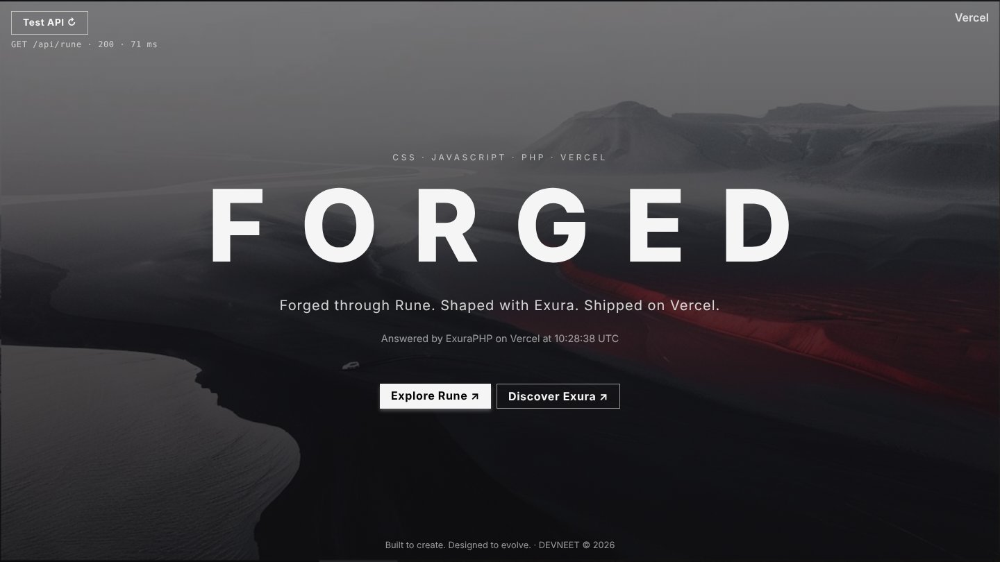

# Relic Web Exura Vercel

**Forged through Rune. Shaped with Exura. Shipped on Vercel.**

A small web app built with Rune and the Exura series, deployed on **[Vercel](https://vercel.com)**: a static page in `dist/`, an API in `api/` that runs as a Vercel PHP function. Write it in many small files in `src/`, and Rune bundles them into two.



**[Explore Rune ↗](https://github.com/devneet-id/rune)**
**[Explore Exura ↗](https://github.com/devneet-id/exura)**
**[Explore Reliquary ↗](https://github.com/devneet-id/reliquary)**

---

## The Relics

This repo holds two **relics**: runites sealed as `.rune`, listed in the **[Reliquary](https://github.com/devneet-id/reliquary)**.

| Relic | `.rune` | Carries |
| ----- | ------- | ------- |
| `devneet-id/relic-web-exura-vercel/cast` | `cast.rune` | the whole app: the runite `cast`, with `src/` (and its vessel), `dist/assets/`, `exura`, `vercel`, `vercel.json`, `router.php`, `.gitignore`, `.vercelignore` and this README as shards |
| `devneet-id/relic-web-exura-vercel/vercel` | `vercel.rune` | the runite `vercel` only; it speaks to the Vercel CLI |

Exura is not a relic of this repo: the runite `exura` comes from **[relic-web-exura](https://github.com/devneet-id/relic-web-exura)** (`devneet-id/relic-web-exura/exura`), and is updated from there.

### Get the app

**From the void** — a new folder, Rune and one awakening file:

```bash
composer require devneet/rune
```

```php
#!/usr/bin/env php
<?php
require_once __DIR__ . '/vendor/autoload.php';

Rune\Ethereal::awakening();
```

Save it as `cast`, then:

```bash
php cast
```

Answer `y`, and choose `devneet-id/relic-web-exura-vercel/cast`.

**Into a runite you already have:**

```bash
php cast reliquary --relic-runite=devneet-id/relic-web-exura-vercel/cast
```

**Or clone this repo:**

```bash
git clone https://github.com/devneet-id/relic-web-exura-vercel.git
cd relic-web-exura-vercel
composer install
php exura setup
php cast start
```

Then open `http://127.0.0.1:8000` and press **Test API**.

### Get Vercel only

For an app of your own: save the same awakening file as `vercel`, beside your `cast`, then:

```bash
php vercel
```

Answer `y`, and choose `devneet-id/relic-web-exura-vercel/vercel`. Or, from a `vercel` runite you already have:

```bash
php vercel reliquary --relic-runite=devneet-id/relic-web-exura-vercel/vercel
```

Then `php vercel init`, and `php vercel code` for `src/vessel/vercel.php`.

### Update Exura

The runite `exura` follows its relic in **[relic-web-exura](https://github.com/devneet-id/relic-web-exura)**:

```bash
php exura reliquary --relic-runite=devneet-id/relic-web-exura/exura --yes
php exura setup
```

---

## Made with Rune

This app holds three **runites**, all engraved from the origin runes of **[Rune](https://github.com/devneet-id/rune)**, a lore-driven, modular concept beneath PHP:

| Runite | Job |
| ------ | --- |
| `cast` | builds, serves, watches and stores the app |
| `exura` | installs and removes the Exura series from the CDN |
| `vercel` | installs the Vercel CLI, links, publishes and keeps the environment variables |

| Rune | Role in this app |
| ---- | ---------------- |
| Aether | opens and closes the flow |
| Chanter | registers the casts |
| Whisper | speaks to the user and asks |
| Weaver | fills the templates while bundling |
| Crafter | bundles `src/` into `dist/index.html` and `api/index.php` |
| Forger | fetches, writes and removes files |
| Cipher | gives every bundle its hash |
| Keeper | remembers the shards in `.echoes` |
| Specter | serves, watches, and runs the Vercel CLI beside the flow |

Want to engrave your own? Start from the **[Rune repository](https://github.com/devneet-id/rune)**.

### Requirements

* PHP 8.1+ with `curl` (or `allow_url_fopen`)
* Composer
* Rune 1.20+ *(for the reliquary)*
* [Vercel CLI](https://vercel.com/docs/cli) *(to deploy)*: `php vercel init` installs it

---

## The App

```
src/
├── index.head.html   goes into <head>
├── index.html        goes into <body>
├── index.css         becomes <style>
├── index.js          becomes <script>
├── index.php         the API
└── vessel/           every library lives here, bundled first
    ├── exura.css     php exura css
    ├── exura.js      php exura js
    ├── exura.php     php exura php
    ├── vercel.php    php vercel code
    └── README.md
dist/
├── index.html        the page (php cast build)
└── assets/
    ├── background.jpg
    └── snapshot.jpg  the picture of this README
api/
└── index.php         the API (php cast build), a Vercel function
vercel.json           the routes and the PHP runtime of Vercel
router.php            the same routes, locally (php cast serve)
```

`php cast build` sparks two items:

| Item | From | To | Holds |
| ---- | ---- | -- | ----- |
| `frontend` | `src/vessel/*` then `src/index.*` (html, css, js) | `dist/index.html` | the page, with ExuraCSS and ExuraJS inside |
| `backend` | `src/vessel/*.php` then `src/index.php` | `api/index.php` | the API, with ExuraPHP and `Vercel::` inside |

* Edit only `src/`. `dist/index.html` and `api/index.php` are made by `php cast build`.
* **The vessel** is `src/vessel/`, the home of every library. `php cast build` takes it per folder: its html, css and js go to the page, its php to the API, always before `src/index.*`. A new library there joins the bundle, no need to list it in `cast`.
* Put images and fonts in `dist/assets/`. The page reads them as `assets/...`.
* **The background** is `dist/assets/background.jpg`. Drop your own image there, no rebuild needed.

| Exura part | In this app |
| ---------- | ----------- |
| ExuraCSS | layout as attributes (`flex`, `size`, `misc`, `button`) and dark mode with `body[dark]` |
| ExuraJS | the `<exura-rune>` module: the **Test API** button, its status and the message |
| ExuraPHP | `GET /api/rune`, answered as JSON; any other `/api/*` answers `404` |

### The routes

`vercel.json` sends every request to the right place:

| Request | Goes to |
| ------- | ------- |
| `/api/*` | `api/index.php` (runtime `vercel-php`) |
| `/*` | `dist/*` |

Locally, `php cast serve` runs `router.php`, which reads the same `vercel.json` on every request — change the routes once, both sides follow. `router.php` and `src/` are left out of the deploy by `.vercelignore`.

---

## Registered Casts

### cast

| Cast | Description |
| ---- | ----------- |
| `build` | Bundle `src/` into `dist/index.html` and `api/index.php`, then store. |
| `serve` | Serve like Vercel on `127.0.0.1:8000`. |
| `watch` | Rebuild when `src/` changes. |
| `start` | Build, then serve and watch. |
| `store` | Keep the assets as shards. |

### exura

| Cast | Spells | Description |
| ---- | ------ | ----------- |
| `setup` | `--dist` `--tags` `--install` | Set where and which version, then install. |
| `css` | `--install` `--remove` `--tags` `--part=clip` | Install or remove `exura.css` (or `exura-clip.css`). |
| `js` | `--install` `--remove` `--tags` | Install or remove `exura.js`. |
| `php` | `--install` `--remove` `--tags` | Install or remove `exura.php`. |

* Keep Exura in `src/vessel/` (`EXURA_DIST`): both items bundle it from there.
* `--tags` is a tag (`1.1.0`) or a branch (`1.x`, the latest of 1.x). Without it, `EXURA_TAGS` is used.

### vercel

| Cast | Spells | Description |
| ---- | ------ | ----------- |
| `init` | | Check or install the Vercel CLI. |
| `code` | | Make `src/vessel/vercel.php` for the API. |
| `link` | | Link this folder to Vercel (logs in when needed). |
| `publish` | | Deploy to production. |
| `env` | `--target` | List and manage environment variables. |
| `env:add` | `--key` `--value` `--target` | Add a new environment variable. |
| `env:set` | `--key` `--value` `--target` | Make or change an environment variable. |
| `env:remove` | `--key` `--target` | Remove an environment variable. |
| `info` | | Casts, versions, install and project. |

* `--target` is `production`, `preview` or `development`. Without it, `VERCEL_TARGET` is used.
* `Vercel::env()`, `Vercel::is()`, `Vercel::target()`, `Vercel::url()`, `Vercel::region()` are ready in the API once `src/vessel/vercel.php` is there.

---

## Try it

Run every command inside this folder.

**The main screens** — every cast with its echo:

```bash
php cast
php exura
php vercel
```

**Exura** — install the series:

```bash
php exura setup                                        # asks: where? install now?
php exura setup --dist=src/vessel/ --tags=1.1.0 --install
```

**Build and develop** — `serve` and `watch` run until **Ctrl+C**:

```bash
php cast build
php cast serve                                         # http://127.0.0.1:8000, like Vercel
php cast watch                                         # rebuild on every change in src/
php cast start                                         # build, then serve & watch in their own windows
```

**The API** — locally, then on Vercel:

```bash
curl "http://127.0.0.1:8000/api/rune"
curl "https://<your-app>.vercel.app/api/rune"
```

**Ship** — to Vercel:

```bash
php vercel init                                        # once: the Vercel CLI
php vercel link                                        # once: log in and link
php cast build
php vercel publish                                     # to production
php vercel info
```

**Environment variables** — read them in the API with `Vercel::env()`:

```bash
php vercel code                                        # once: src/vessel/vercel.php
php vercel env
php vercel env:add --key=GREETING --value=hello
php vercel env:set --key=GREETING --value=hi --target=preview
php vercel env:remove --key=GREETING
```

**Share** — every runite seals its own relic:

```bash
php cast store
php cast reliquary --runite-relic                      # cast   -> cast.rune   (the app)
php vercel reliquary --runite-relic                    # vercel -> vercel.rune (Vercel only)
```

**Built-in casts of Rune** — every runite carries them: `grimoire`, `reliquary` and `sentinel`.

---

## What you learn

| Runite · Cast | Lesson |
| ------------- | ------ |
| `cast build` | Crafter: two items from one `src/`, each with its own seed · Forger: one vessel, split by language |
| `cast serve`, `watch`, `start` | Specter: a dev server with a router, an observer, casts beside the flow |
| `cast store` | Keeper: shards travel with the relic |
| `exura setup`, `css`, `js`, `php` | Whisper asks; Forger fetches, writes and removes |
| `vercel init`, `link`, `publish`, `env:*`, `info` | run another CLI, with `Whisper::flash` while it works |
| two relics | `cast` and `vercel` sealed on their own; `exura` comes from another repo |

**A web app is many files, Rune makes it two, Vercel ships them.**

---

## References

* [Rune](https://github.com/devneet-id/rune) — Application foundation and tooling.
* [Rune Lore](https://github.com/devneet-id/rune-lore) — The full documentation, from the void to the beyond.
* [Reliquary](https://github.com/devneet-id/reliquary) — The relics of Rune.
* [ExuraCSS](https://github.com/devneet-id/exuracss) — Styling framework.
* [ExuraJS](https://github.com/devneet-id/exurajs) — JavaScript framework.
* [ExuraPHP](https://github.com/devneet-id/exuraphp) — PHP framework.
* [Vercel](https://vercel.com) — The platform this app is shipped on.
* [vercel-php](https://github.com/vercel-community/php) — The PHP runtime for Vercel functions.

---

**Built to create. Designed to evolve.**

**DEVNEET ©**
